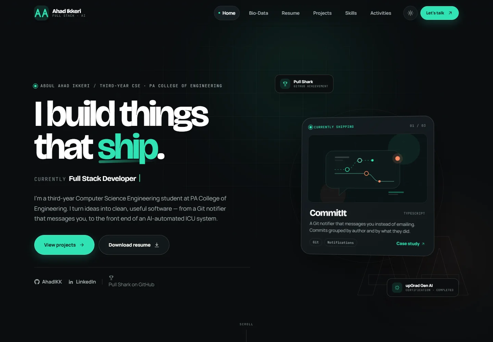
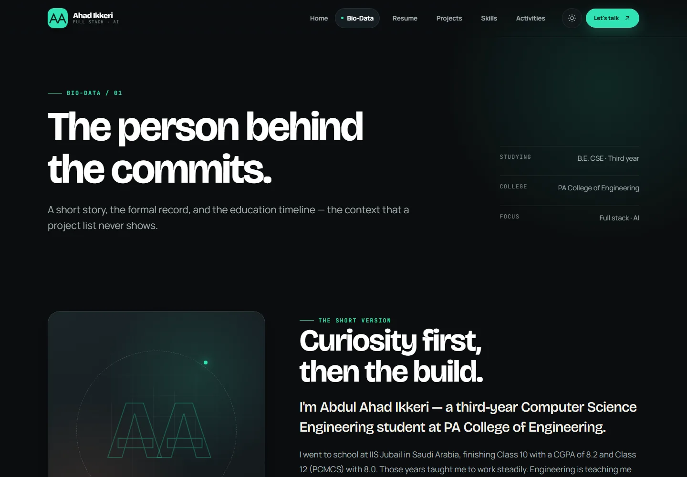
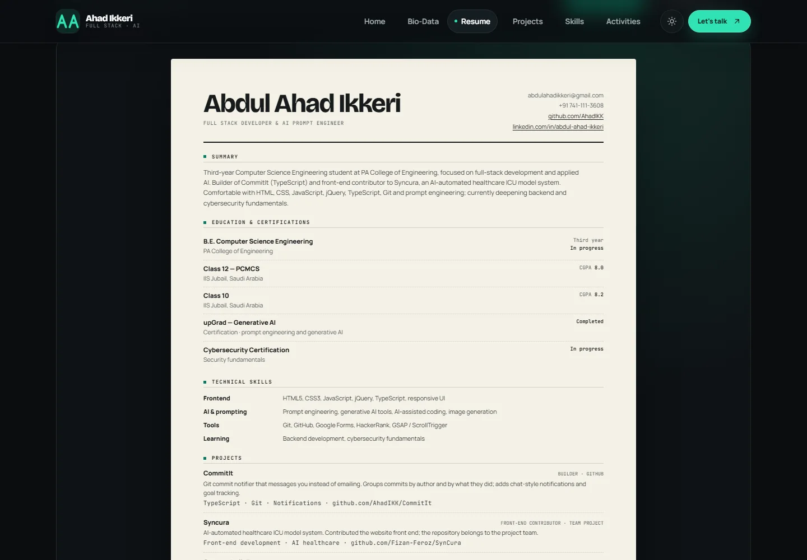
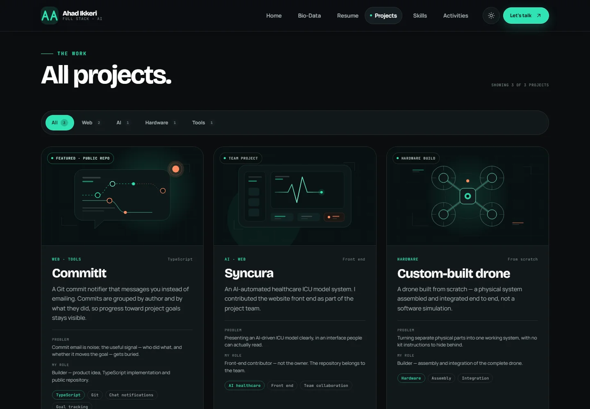
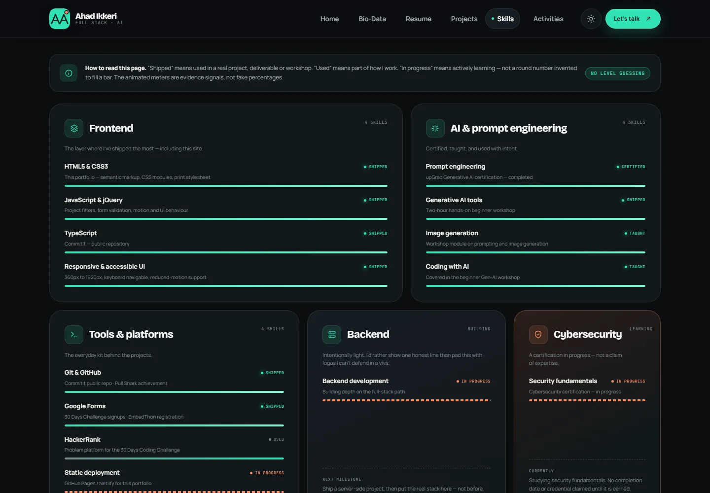
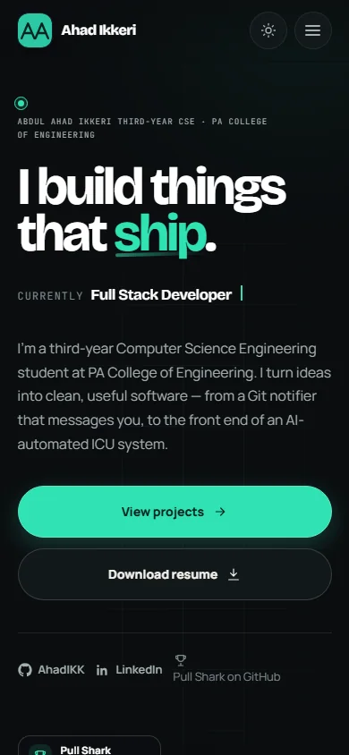

# Abdul Ahad Ikkeri — Portfolio

**Full Stack Developer & AI Prompt Engineer who builds things that ship.**

Third-year B.E. Computer Science Engineering student at PA College of Engineering.
A multi-page portfolio with a real bio-data record, an ATS-friendly resume, project case studies, and the events behind the work.

> **Live:** **https://ahadikk.github.io/** — deployed from this repository via GitHub Pages.
> **Backup:** deploy the same folder to Netlify (instructions below).



---

## 1. What this is

A static, multi-page portfolio built for a college assignment and for real internship applications. It deliberately avoids invented metrics, fake skill percentages, and stock project screenshots. Every project is described by the problem, the build, my role and the honest outcome.

| Page | File | What the visitor gets |
| --- | --- | --- |
| Home | `index.html` | Animated hero, positioning, true stats, selected work, social proof |
| Bio-Data | `about.html` | Formal `<table>` record, quick facts, personal story, education timeline, declaration |
| Resume | `resume.html` | ATS-friendly on-screen resume + one-page A4 print stylesheet + PDF download |
| Projects | `projects.html` | jQuery filters, three case-study cards, accessible `<dialog>` write-ups |
| Skills | `skills.html` | Evidence-based groups: frontend, AI, tools, backend and cybersecurity |
| Achievements | `achievements.html` | Certifications, GitHub Pull Shark, event leadership timeline |
| Contact | `contact.html` | Validated form, Formspree / mailto fallback, copy-email toast, social links |
| 404 | `404.html` | Playful “this commit doesn’t exist” page for GitHub Pages |

The site is **plain HTML5, CSS3, JavaScript and jQuery** — no React, no build step, no framework. GSAP + ScrollTrigger handle scroll motion; the files are local so the site also works offline.

---

## 2. Features

- **Multi-page sharing model** — fixed glass navigation, active-page state, footer navigation, relative paths for GitHub Pages project sites.
- **Resume that prints** — real text (no image), standard headings, one-page A4 `@media print` output. Download button uses `assets/resume/Abdul-Ahad-Ikkeri-Resume.pdf`.
- **Bio-data done properly** — `<table>`, `<dl>`, `<fieldset>`, `<address>`, `<time>`, a vertical education timeline and a declaration.
- **jQuery project filter** — All / Web / AI / Hardware / Tools, live counts and an `aria-live` result.
- **Accessible case-study dialogs** — native `<dialog>`, focus return, Esc/backdrop close, deep links like `projects.html#commitit`.
- **Contact form** — inline validation, `aria-invalid`, `aria-describedby`, keyboard-friendly errors, Formspree post or `mailto:` fallback.
- **Theme system** — dark-first identity with a full light theme. First visit follows `prefers-color-scheme`; the toggle is saved in `localStorage`; the theme is applied before first paint to prevent a flash.
- **Motion with a safety net** — preloader, GSAP reveals, typing effect, counters, skill meters, timeline draw, card tilt, magnetic buttons, page transitions. All disabled or reduced under `prefers-reduced-motion`; content has a visibility fallback.
- **Print / share / SEO** — A4 print CSS, designed `og.png` 1200×630, favicon, web manifest, `sitemap.xml`, `robots.txt`, JSON-LD `Person`, canonical URLs.
- **Accessibility** — skip link, one `h1` per page, correct heading order, visible focus, labelled fields, 4.5:1 contrast, no keyboard traps. Audit: axe 0 issues; Lighthouse Accessibility 100.

---

## 3. Tech stack

| Layer | Choice | Why |
| --- | --- | --- |
| Markup | HTML5 | Required by the brief; semantic elements are the rubric |
| Styling | CSS3 modules | Readable for a viva: tokens, base, layout, components, pages, animations, print |
| Behaviour | Vanilla JS + jQuery 3.7.1 | jQuery for DOM/filter/form behaviour, as requested |
| Motion | GSAP 3.12 + ScrollTrigger | Smooth transforms, stagger, parallax, timeline draw |
| Fonts | Bricolage Grotesque, Manrope, JetBrains Mono | Self-hosted (WOFF2) for performance and offline use |
| Icons | Inline SVG | No external request; no emoji-as-icons |
| Hosting | GitHub Pages (primary), Netlify (backup) | Free static hosting, custom 404 |

**No build step.** Open `index.html` or serve the folder:

```powershell
# From the portfolio folder
python -m http.server 4173
# Visit http://127.0.0.1:4173/
```

---

## 4. Folder structure

```text
Portfolio/
├── index.html
├── about.html          # Bio-data
├── resume.html
├── projects.html
├── skills.html
├── achievements.html
├── contact.html
├── 404.html
├── favicon.svg
├── og.png              # 1200x630 social share image
├── site.webmanifest
├── sitemap.xml
├── robots.txt
├── .nojekyll           # keep GitHub Pages from running Jekyll
├── css/
│   ├── tokens.css      # fonts, colour themes, spacing, type scale
│   ├── base.css        # reset, typography, utilities, accessibility
│   ├── layout.css      # header, nav, hero shell, footer
│   ├── components.css  # buttons, cards, filters, dialog, forms, timeline
│   ├── pages.css       # page-specific composition
│   ├── animations.css  # keyframes, reduced-motion overrides
│   └── print.css       # one-page A4 resume
├── js/
│   ├── profile-render.js
│   ├── ui.js
│   ├── animations.js
│   ├── home.js
│   ├── projects.js
│   ├── contact.js
│   └── vendor/         # local jQuery, GSAP, ScrollTrigger
├── data/
│   └── profile.js      # ← edit personal data and placeholders here
└── assets/
    ├── fonts/          # self-hosted WOFF2 files
    ├── img/
    │   ├── noise.png
    │   ├── favicon-32.png
    │   ├── apple-touch-icon.png
    │   ├── icon-192.png
    │   ├── icon-512.png
    │   └── screenshots/  # README images only
    └── resume/
        └── Abdul-Ahad-Ikkeri-Resume.pdf
```

No image assets are loaded by the site itself apart from the optional portrait and noise texture. Project visuals are custom inline SVG, so there are no broken image links and no stock-photo look.

---

## 5. Edit your data once: `data/profile.js`

Every page reads from `window.PROFILE` in **`data/profile.js`**. Edit that one file; `js/profile-render.js` replaces `[data-profile]` text and `[data-link]` URLs at runtime.

The current copy has the personal fields filled in. The portrait is intentionally blank so the **AA** monogram is used, and the contact form uses the mailto fallback until a Formspree endpoint is added. The table below is the full set of keys to check if you reset or reuse the template.

### What lives there

- Name, roles, summary and availability
- Email, phone, date of birth, nationality, address, languages, hobbies
- Optional portrait path
- GitHub, LinkedIn, CommitIt and Syncura URLs
- Resume PDF path
- Formspree endpoint
- True stat counts used in the home stats band
- Education summary used in copy

### Placeholders

Replace every value below before publishing:

| Placeholder | Where it appears | Suggested value |
| --- | --- | --- |
| `[[YOUR_EMAIL]]` | Bio-data, resume, contact card, copy button, mailto fallback | `you@example.com` |
| `[[YOUR_PHONE]]` | Bio-data, resume, contact card | your number |
| `[[YOUR_DOB]]` | Bio-data table | `DD Month YYYY` |
| `[[YOUR_NATIONALITY]]` | Bio-data table | your nationality |
| `[[YOUR_ADDRESS]]` | Bio-data table, contact card | city, state, country |
| `[[YOUR_LANGUAGES]]` | Bio-data table | your languages |
| `[[YOUR_HOBBIES]]` | Bio-data table | your real hobbies |
| `[[YOUR_PHOTO]]` | About portrait | `assets/img/profile.webp` (or leave to use the monogram) |
| `[[FORMSPREE_ENDPOINT]]` | Contact form | `https://formspree.io/f/xxxxxxx` |

As long as a value still contains `[[…]]`, it is styled with a dashed ember underline and a “fill this in” note. Once you replace it, those cues disappear automatically.

If you **don’t want a portrait**, set `photo: ""` (empty string) instead of the placeholder; the monogram stays and the warning clears. If you prefer the **mailto-only** form, set `formspreeEndpoint: ""`.

The included PDF has been regenerated from the current profile data, so it carries the real email and phone number. Regenerate it again after any future edits to contact details (section 7).

### Why the skills page has no invented percentages

The brief said not to guess skill levels. Rather than print made-up numbers, the skills page labels each item with evidence: **Shipped**, **Certified**, **Taught**, **Used**, or **In progress**. The animated meters are evidence signals, not levels. If you later want numeric bars, add a `level` value to each skill row in `skills.html` and set `width`/`scaleX` in CSS — but do not publish a number you cannot defend in a viva.

### Update the canonical / social URLs

The HTML uses `https://ahadikk.github.io/` as the suggested deployment URL. If you deploy to:

- `https://ahadikk.github.io/portfolio/`, or
- a Netlify URL,

update these in **all eight HTML files**:

- `<link rel="canonical" …>`
- `<meta property="og:url" …>`
- `<meta property="og:image" …>` (the image URL)
- `<meta name="twitter:image" …>`

and update `sitemap.xml` + `robots.txt`. Search for `ahadikk.github.io` across the project to find them all.

---

## 6. Contact form setup

The form does **not** pretend to send if it is not configured.

### Option A — Formspree (recommended for GitHub Pages)

1. Sign in at [formspree.io](https://formspree.io/).
2. Create a new form, for example `Portfolio contact`.
3. Copy the endpoint: `https://formspree.io/f/xxxxxxxx`.
4. Paste it into `PROFILE.formspreeEndpoint` in `data/profile.js`.
5. Set `PROFILE.email` to your real email too (used by the mailto fallback and copy button).
6. Open `contact.html`, submit a test message, and confirm it arrives.

When the endpoint is valid, `contact.js` posts `FormData` with `Accept: application/json`, disables the button while sending, and announces success via an `aria-live` status.

### Option B — mailto fallback

If `formspreeEndpoint` is left as a placeholder but `email` is real, the form opens the visitor’s email app with the name, email, subject and message pre-filled. The page explains that the email app should open; it does not claim the message was sent automatically.

### Option C — Netlify Forms

If you use Netlify and want Netlify Forms instead of Formspree:

1. Add `name="contact" data-netlify="true"` to `#contact-form`.
2. Add `<input type="hidden" name="form-name" value="contact">`.
3. Remove or bypass the `fetch` branch in `js/contact.js` so the native form submission reaches Netlify.
4. Redeploy and submit a test entry under **Forms** in Netlify.

The shipped version uses Formspree/mailto because it deploys cleanly on GitHub Pages too.

---

## 7. Regenerate the resume PDF (after future edits)

The included PDF was generated from `resume.html` with the current contact details and is **one A4 page**. After any future edits to `data/profile.js`:

1. Open `resume.html` in Chrome or Edge (online or through the local server).
2. Click **Print / save as PDF** (or press `Ctrl+P`).
3. Destination: **Save as PDF**.
4. Paper size: **A4**.
5. Margins: **None**.
6. Headers and footers: **off**.
7. Background graphics: **on**.
8. Save over `assets/resume/Abdul-Ahad-Ikkeri-Resume.pdf`.
9. Open the PDF and confirm it is **one page** and the email/phone are real.

The print stylesheet hides the site header, hero, toolbar, footer, the empty Experience block and the on-screen notes. It keeps Summary → Education & Certifications → Technical Skills → Projects → Leadership in an ATS-friendly single column.

---

## 8. Deploy — GitHub Pages (primary)

### Before you start

- Create a free GitHub account (or use `AhadIKK`).
- Decide the repository name:
  - **`ahadikk.github.io`** → site at `https://ahadikk.github.io/` (recommended, cleanest).
  - **`portfolio`** → site at `https://ahadikk.github.io/portfolio/` (then update canonical/OG/sitemap URLs and every absolute link to `og.png`).
- Verify the email/phone in `data/profile.js` and the PDF are current (the supplied copy already is).

### Click-by-click

1. Sign in at [github.com](https://github.com/).
2. Click **+ → New repository**.
3. Repository name: `ahadikk.github.io` (or `portfolio`).
4. Set visibility to **Public**.
5. Do **not** add a README, `.gitignore`, or license (you already have files).
6. Click **Create repository**.
7. On the empty repository page, choose **uploading an existing file**.
8. Drag the **contents** of the `Portfolio` folder into the upload area — not the folder itself. The repository root must contain `index.html`, `404.html`, `css/`, `js/`, `data/`, `assets/`, `og.png`, etc.
9. Commit message: `Build portfolio: resume, bio-data and case studies`.
10. Click **Commit changes**.
11. Open **Settings → Pages**.
12. Under **Build and deployment**, set **Source** to **Deploy from a branch**.
13. Branch: **main**; folder: **/ (root)**.
14. Click **Save**.
15. Wait 1–3 minutes. The page will show “Your site is live at …”.
16. Visit the URL and hard-refresh (`Ctrl+Shift+R`).

### Or deploy with Git from this folder

```powershell
cd C:\Users\nikea\Documents\Portfolio

git init
git add .
git commit -m "Build portfolio: resume, bio-data and case studies"
git branch -M main
git remote add origin https://github.com/AhadIKK/ahadikk.github.io.git
git push -u origin main
```

Then follow steps 11–16. The repo name in the remote URL must match the repository you created. If you use `portfolio`, change the remote to `.../portfolio.git`.

### Custom 404

- `404.html` is at the repository root.
- GitHub Pages serves it automatically for missing project URLs.
- Test it at `https://ahadikk.github.io/this-page-does-not-exist`.
- The page is marked `noindex` and is excluded from `sitemap.xml`.

### After deployment — link test

- [ ] Home, Bio-Data, Resume, Projects, Skills, Activities and Contact links work from the header and footer.
- [ ] The mobile menu opens, closes on Escape, and links work.
- [ ] The Resume **Download PDF** button downloads the PDF.
- [ ] The Print button opens the browser print dialog and fits one A4 page.
- [ ] Project filters show the right cards and live counts.
- [ ] Each case study dialog opens, closes on Escape/backdrop, and returns focus.
- [ ] Contact validation shows inline errors; a configured Formspree endpoint accepts a test message.
- [ ] Copy-email shows a toast, or tells you to fill the placeholder.
- [ ] `/404.html` and a missing URL both show the custom 404.
- [ ] GitHub and LinkedIn links open the correct profiles.
- [ ] The share image preview appears in the LinkedIn Post Inspector / WhatsApp link preview.
- [ ] `https://ahadikk.github.io/robots.txt` and `/sitemap.xml` load.
- [ ] Lighthouse mobile run is 90+ in all four categories.
- [ ] The site still works when the local `file://` copy is opened (fonts/libraries are local; external links need internet).

---

## 9. Deploy — Netlify (backup)

### Drag-and-drop

1. Sign in at [app.netlify.com](https://app.netlify.com/).
2. Go to [app.netlify.com/drop](https://app.netlify.com/drop).
3. Drag the whole `Portfolio` folder onto the drop zone.
4. Wait for the deploy; copy the `*.netlify.app` URL.
5. Open the URL and test the same checklist as above.
6. `404.html` is served automatically for missing paths.

### Git-connected (optional)

1. Push the folder to GitHub first.
2. Netlify → **Add new site → Import an existing project**.
3. Choose GitHub and the repository.
4. Build command: leave blank.
5. Publish directory: `.` (the repository root).
6. Deploy.

If Netlify is your primary URL, update all canonical/OG/sitemap URLs from `ahadikk.github.io` to your Netlify domain.

---

## 10. Screenshots

| Home | Bio-data |
| --- | --- |
|  |  |

| Resume | Projects |
| --- | --- |
|  |  |

| Skills | Mobile home |
| --- | --- |
|  |  |

---

## 11. Accessibility, motion and performance

### Accessibility

- Semantic landmarks: `header`, `nav`, `main`, `section`, `article`, `aside`, `footer`, plus `figure`, `time`, `address`, `table`, `dl` and `fieldset`.
- One `h1` per page and a logical heading order.
- Skip-to-content link; `main` receives focus.
- All form fields have visible labels and explicit error connections.
- Focus-visible outlines; no focus traps. The native dialog handles focus.
- Colour contrast: all text checked at 4.5:1 or better in both themes (axe: 0 violations).
- `prefers-reduced-motion: reduce` disables the preloader, cursor, parallax, float, reveals and page transitions; all content is instantly visible.
- No content is permanently hidden behind JavaScript: reveal animations have a viewport failsafe, and the site is usable with JavaScript off (navigation and content still render; interactive form/filter controls degrade).

### Performance

Local Lighthouse audit on 10 Nov 2026 (mobile, simulated throttling):

| Category | Score |
| --- | --- |
| Performance | **98** |
| Accessibility | **100** |
| Best Practices | **100** |
| SEO | **100** |

Key choices: local fonts and libraries, no framework, no image-heavy hero, custom SVG art, deferred JS, CSS transforms/opacity for motion, and one small noise texture. LCP 1.8s, CLS 0.02, TBT 0ms on the test run. Scores vary by machine/network; run **Chrome DevTools → Lighthouse → Mobile** after deploying.

### Theme

On the first visit the site follows the operating system’s `prefers-color-scheme`. The toggle updates `data-theme`, stores `aai-theme` in `localStorage`, updates the browser `theme-color`, and survives reloads. To force dark-first regardless of OS, change the inline theme script in each page to default to `"dark"`.

---

## 12. Rubric mapping

| Assignment requirement | Where it is met | Evidence |
| --- | --- | --- |
| "Construct a Website (multiple Web pages)" | All 8 pages | Linked header/footer; active nav state; custom 404 |
| “Resume” | `resume.html` | On-screen ATS resume + `assets/resume/Abdul-Ahad-Ikkeri-Resume.pdf` |
| “Bio-data” | `about.html` | `<table>` personal record, `<dl>` quick facts, `<fieldset>` declaration, education timeline |
| “Relevant HTML elements” | All pages | `header`, `nav`, `main`, `section`, `article`, `aside`, `footer`, `figure`, `time`, `address`, `dl`, `table`, `fieldset` |
| “Appropriate styling with CSS” | `css/*.css` | 7 CSS modules, tokens, responsive layout, dark/light themes, print CSS |
| “jQuery / JavaScript” | `js/*.js` + local vendor libs | Theme persistence, mobile nav, project filter, dialog, form validation, copy-email toast, counters, typing, scroll reveals |
| “Host on a cloud platform” | Section 8–9 | GitHub Pages primary; Netlify backup; exact steps and verification checklist |
| Extra: accessibility | All pages | Skip link, landmarks, labels, contrast, reduced motion; axe 0 |
| Extra: SEO/share | All pages | Meta, canonical, OG/Twitter, JSON-LD, sitemap, robots, designed `og.png` |
| Extra: print | `css/print.css` | @page A4, one-page output, hides UI and empty sections |

---

## 13. Two-minute demo script

**0:00 — Home.** “This is my portfolio. I’m a third-year CSE student at PA College of Engineering, positioning myself as a Full Stack Developer and AI Prompt Engineer. The hero uses a typewriter effect, and these counters show only three projects, two certifications and four events — all true.” Toggle the theme and point out that it is remembered.

**0:20 — Bio-Data.** Open Bio-Data. “This is the formal record: a real table, a quick-facts definition list, a declaration fieldset, and an education timeline from IIS Jubail to PA College of Engineering. The CGPA values are 8.2 and 8.0.”

**0:40 — Resume.** Open Resume. “The resume is real text, single column and ATS-friendly: Summary, Education and Certifications, Technical Skills, Projects, an Experience section ready for my first internship, and Leadership. The print stylesheet turns it into one A4 page.” Click Print briefly, or show the downloaded PDF.

**1:00 — Projects.** Open Projects. Click **AI** and explain the jQuery filter and live result count. Open **CommitIt** and walk through problem → approach → stack → my role → outcome. “For Syncura I’m explicit that I was the front-end contributor, not the owner; the repo belongs to the team. The drone is the hardware project.”

**1:30 — Skills.** Open Skills. “I did not invent percentages. Each skill is labelled Shipped, Certified, Taught, Used or In progress, with the evidence beside it. The meters animate as evidence signals.”

**1:45 — Achievements.** Open Activities. “IEEE Week 2026 — eight event formats plus the Counter Strike tournament, the 30 Days Coding Challenge, EmbedThon registration, and a two-hour Gen-AI workshop.”

**1:55 — Contact/404.** Open Contact. “The form validates inline and has a Formspree endpoint plus a mailto fallback.” Submit empty to show inline errors, then mention the copy-email toast. Open a missing URL to show the custom 404.

**Close:** “It’s HTML, CSS, jQuery and GSAP, deployed as static files on GitHub Pages — no framework or build step.”

---

## 14. Eight likely viva questions (short answers)

1. **Why did you use multiple pages instead of a single-page React app?**
   The assignment asks for multiple web pages, and the site is hosted on static cloud hosting. Separate HTML files make the Resume and Bio-Data directly linkable, improve crawlability, and avoid a build step. Shared CSS/JS keeps the pages consistent.

2. **How does the project filter work?**
   Each project card has `data-categories` (for example `web tools`). jQuery reads the pressed filter button, checks whether the card’s category list contains it, toggles the `.is-filtered` class, updates the visible count, and sets `aria-pressed`. The result updates an `aria-live` region.

3. **How does the theme stay after a reload?**
   A small inline script in `<head>` reads `localStorage.getItem("aai-theme")` before the page paints, then sets `data-theme` on `<html>`. CSS variables do the rest. The toggle writes the value back and updates `meta[name="theme-color"]`.

4. **How is the resume one page in print?**
   `css/print.css` is loaded with `media="print"`. It sets `@page { size: A4; margin: 0 }`, hides navigation/toolbars/notes, compacts the type, and hides the empty Experience section. The resume is a single column with standard headings and real text, so it prints and parses cleanly.

5. **How did you handle accessibility?**
   Semantic landmarks, one `h1` per page, a skip link, labelled form fields with `aria-describedby`, visible focus, 4.5:1 contrast, native `<dialog>` for focus management, and `prefers-reduced-motion` support. The audit using axe had zero violations and Lighthouse Accessibility scored 100.

6. **What is `data/profile.js` for?**
   It is the single source of personal data. `profile-render.js` fills `[data-profile]` text and `[data-link]` URLs, marks any remaining `[[placeholders]]`, and shows the placeholder warning. That means email, phone, address, social links and the optional photo update across all pages from one file.

7. **How do the animations avoid blocking content?**
   Motion only runs after GSAP and ScrollTrigger are available. Reveals have a viewport failsafe, reduced-motion users get everything instantly, and the preloader automatically fades even without JavaScript. Content is never dependent on an animation completing.

8. **How would you deploy this and what would you change later?**
   Push the static folder to GitHub Pages (or drag it to Netlify). Relative paths and `.nojekyll` keep it portable; `404.html` gives the custom error page. Later I would add a real backend for the form, and replace the evidence labels with numeric skill levels only after I can defend them.

---

## 15. Credits & licences

- **Fonts:** [Bricolage Grotesque](https://fonts.google.com/specimen/Bricolage+Grotesque), [Manrope](https://fonts.google.com/specimen/Manrope), [JetBrains Mono](https://fonts.google.com/specimen/JetBrains+Mono) — Google Fonts, SIL Open Font License. Self-hosted WOFF2 files.
- **Libraries:** [jQuery](https://jquery.com/) (MIT), [GSAP + ScrollTrigger](https://gsap.com/) (GreenSock standard “no charge” licence for this portfolio use).
- **Icons and project art:** custom inline SVG drawn for this project. No icon-font dependency and no stock images.
- **Content:** all personal facts supplied by Abdul Ahad Ikkeri. No invented users, growth numbers, awards or experience.

---

## 16. Honest limitations

- The portrait is intentionally absent so the AA monogram remains the identity. Add a photo path in `profile.js` if you want one.
- The contact form uses the mailto fallback until you add a Formspree endpoint; validation works out of the box.
- Numeric skill percentages were deliberately not invented; the page explains its evidence labels instead. Those labels describe evidence, not certified proficiency.
- The live URL in the meta tags is the suggested GitHub Pages URL until you deploy.
- The AA monogram is a custom geometric mark: two interlocking A forms with the CommitIt ember notification dot.

> **Built from scratch for the “Resume and Bio-data website” assignment — and for the internship search after it.**
